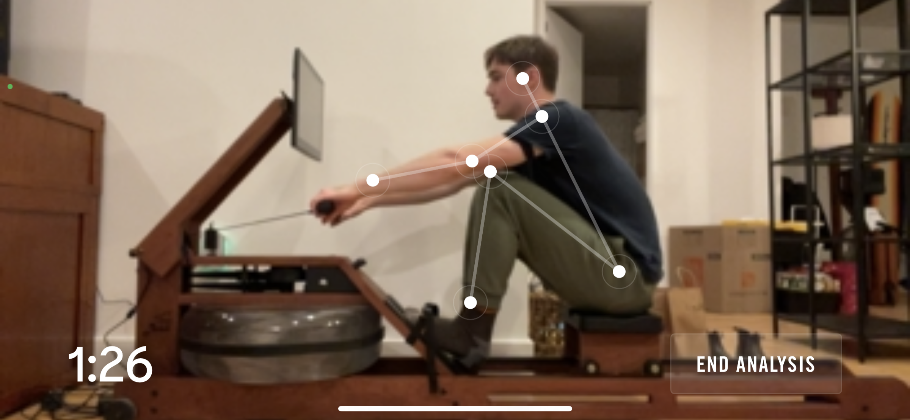
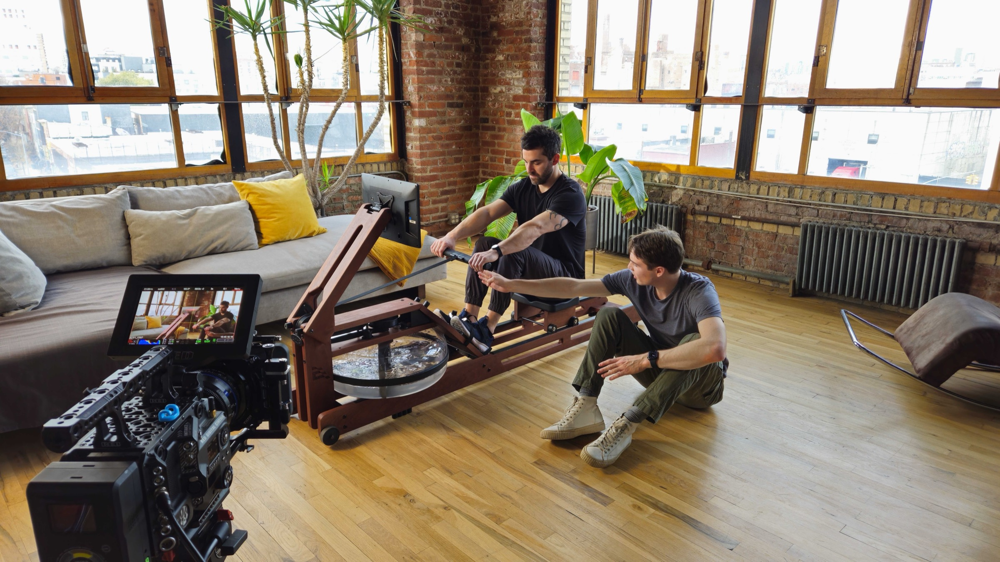
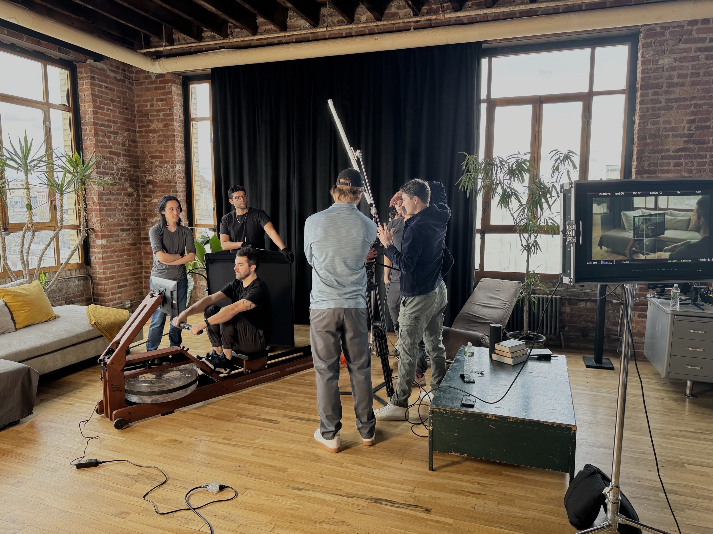

Rowing is hard. Teaching people to row through a phone camera is even harder.

In late 2023, Google released a free vision model that could follow a body
through a phone camera. We used it to build Coach AI, which grades your
technique from a phone set up beside the rower. It tracks posture and cadence,
scores each stroke, and recommends drills and tutorials to raise the score. I
worked with our VPs of product and engineering and our CTO from scoping through
launch. The first versions of the model were trained on my own stroke. I helped
shape the UX and wrote every word in the interface, including how the generated
feedback talks, so the coaching stayed accurate and sounded like Ergatta.

Before kickoff, I pitched the positioning to leadership: the form score as
something worth sharing. I ran the launch from one Notion board, with every
channel tagged to an owner across product, engineering, marketing, sales and
support: paid and organic social, site, lifecycle and winback email, press,
affiliates, community, sales and CX macros, in-product announcements, and the
rollout sequence.

I hired Fritz Bacon to direct and shot 15- and 30-second cuts in a Bushwick
loft, produced the animations showing the model tracking a stroke, and cut the
ads in post. I demoed Coach AI at CES and landed a
[Forbes](https://www.forbes.com/sites/anthonykarcz/2024/01/06/ergatta-wants-to-transform-your-fitness-with-its-game-based-rowers/)
review I sourced and pitched myself.

We expected beginners to adopt it first. Holdout cohorts showed moderate rowers
did, which turned out to be better news. More members crossed our
three-sessions-a-week threshold, the lapsed-member campaign lifted reactivations
more than 20%, and Coach AI helped grow referrals from 5% to more than 20% of
monthly sales. So we shifted messaging toward moderate rowers, launched a
give-and-get referral offer, and put the video library in the companion app so
members could show it off away from home.
