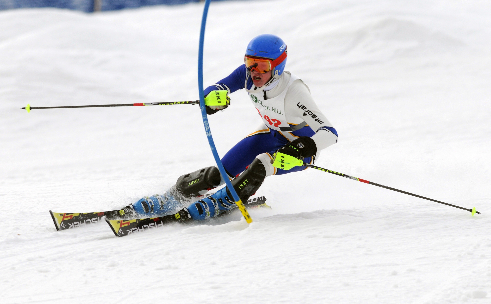
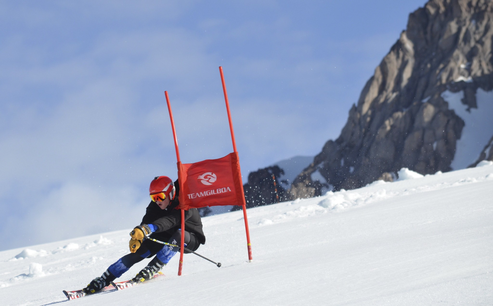
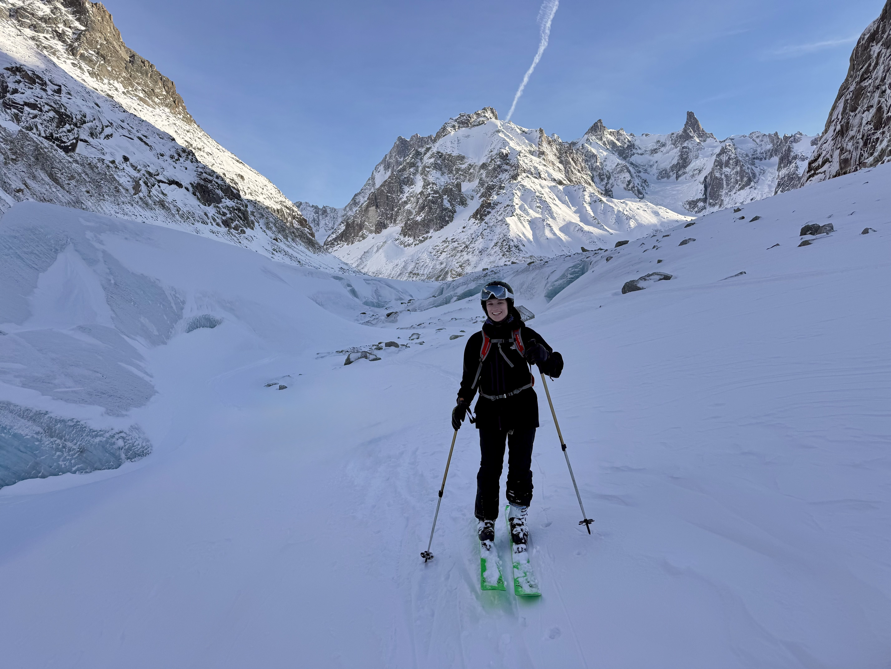
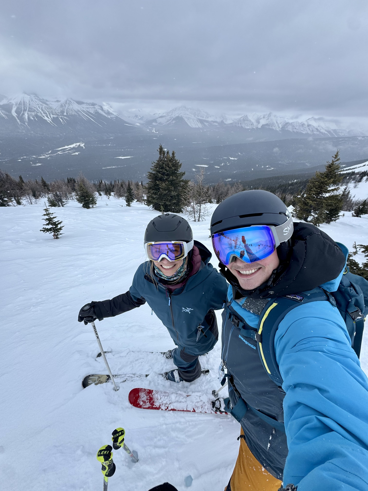
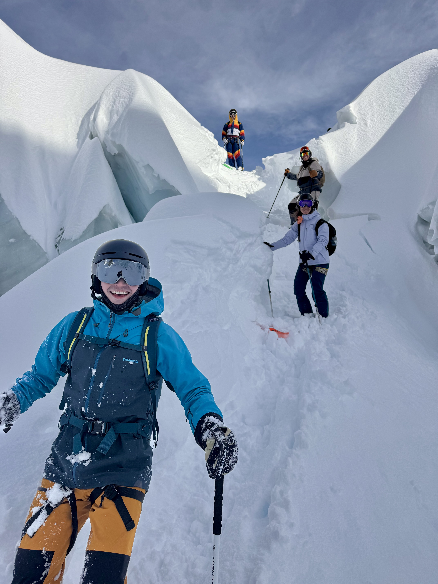

I learned to ski chasing my two older brothers around Big Sky. From Moonlight's
Saddle Ridge, we would look across at the Challenger face and point out the lines
we'd taken through the cornices and over the Midnight cliffs.

In high school, I grabbed a pair of used skis and joined the alpine team,
bringing 11 years of hockey edges with me. Pure joy. I skied every day from
November to May for three teams, qualified for Minnesota State twice
individually, and as captain led my school team to State for the first time in
our history.

Along the way, I went to my first Mount Hood summer camp, a kid on a glacier in
July, and discovered the world of brand demos. I thought I was in a dream. Trying
out two new pairs of skis for free every day?

I fell in love with the nuances of ski design and construction, so much so that I
apprenticed at Gear West under a US Paralympic ski tuner. Once I had the skills
and the gear, I opened my own business tuning my teammates' race skis at $35 a
pair. It may still be my most profitable venture to date.

At Williams College, I joined the ski patrol and ski school at Jiminy Peak,
becoming a certified National Ski Patroller while teaching college students to ski
and training new instructors.

I've skied most of the brands on the wall, and I'm still the friend people text
before they buy a ski, or when their edges need work. The tuning business may
never fully close.

These days, I have the great joy of spending winter weekends in the mountains with
my wife, who grew up skiing at Kirkwood, and our 1-year-old golden retriever, Loon.

