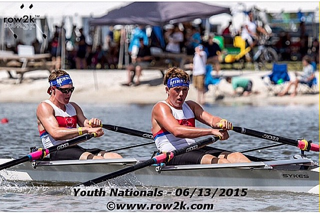
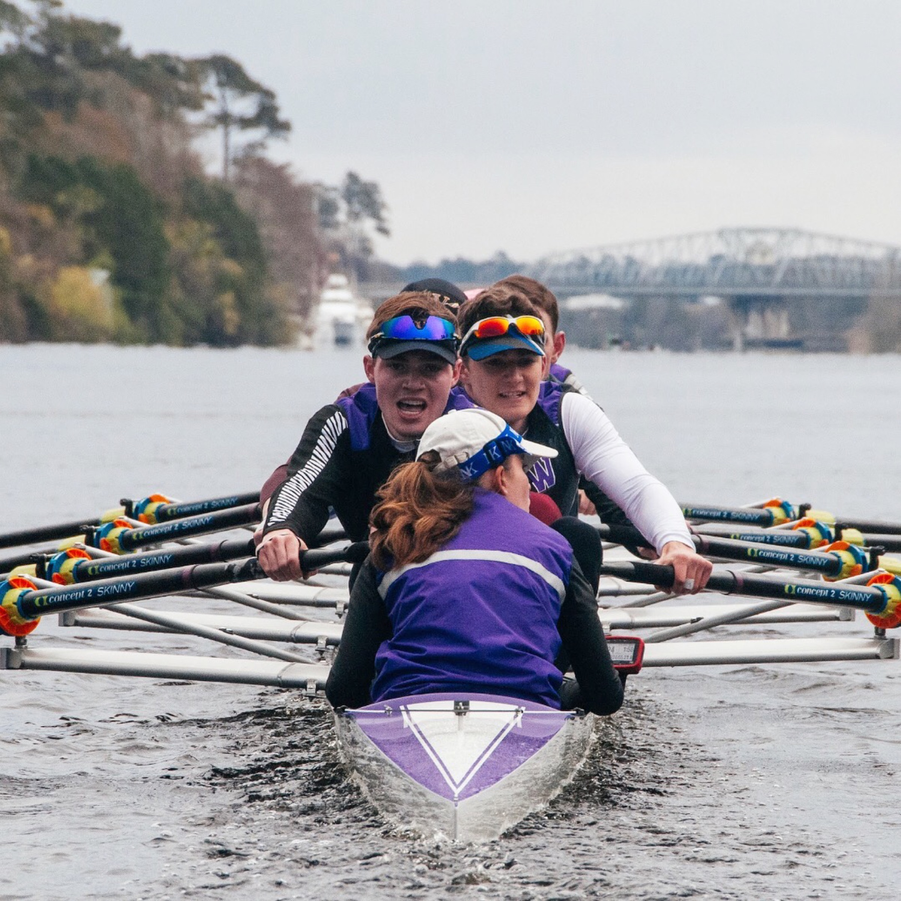
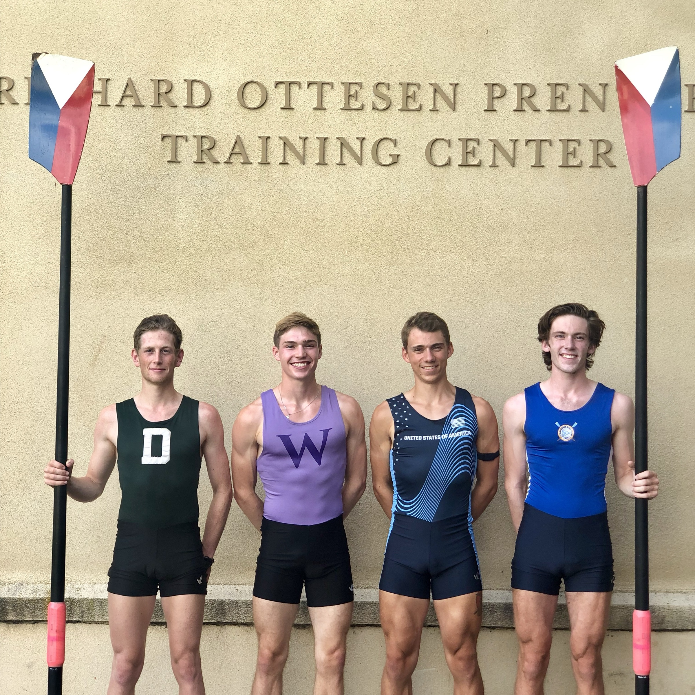

I started rowing by accident. It was 2013 when I picked up an oar for the first
time, and when I realized rowing was not kayaking or canoeing.

Very quickly, I fell in love with the calm water and the thrill of racing. The
sport's blend of technicality and tenacity. I rowed a double scull at the Head of
the Charles that first fall and opened my eyes to an entire world of rowing,
rendezvousing on Boston's river bank.

It was a high tide to ride into my first offseason. Unknowingly, it was also soon
to be my last season. The head coach, filing the serial numbers off the rowing
shells, skipped town with the boats and club bank account.

Despite all of the lakes, there were only six rowing clubs in Minnesota at the
time, and none of them close. So, rallying together, a core group of teammates,
parents, community supporters, and I founded Long Lake Rowing Crew in the old
club's place. We established a 501(c)(3) board and raised funds for a new fleet
by the spring thaw. For land training, we leased a warehouse for $1, occupied
only by bloody rats in the toilet that sat in the corner. Every wall was stripped
to the studs. To launch for water practice, we parked in a cemetery neighboring
an abandoned lakeside restaurant, where we kept our boats on wooden stands in the
parking lot, also leased for $1. By 2015, we partnered with local business
leaders to convert the warehouse into a CrossFit gym, and the boarded-up
restaurant into a supper club, brewery, and vibrant rowing club that continues to
operate at a 100-youth-rower capacity.

At Williams College, on a mountain lake in the Berkshires, I had the joy of
rowing stroke seat in the first freshman boat and then in the first varsity boat
for three years, finishing out my time as captain.

In 2019 I was invited to try out for the U23 National Team Selection Camp, where
36 of the fastest collegiate rowers skinny down to 160 lbs. to fight for four
slots in the United States lightweight men's quad. What followed was six weeks of
the most aggressive competition in my life. I made the boat, won a second bid to
the World Championships by winning the heavyweight category at U.S. Trials, and
placed fourth at the U23 World Championships.

Through the pandemic, and up to today, I am still getting out on the water in my
own single rowing shell, SOL. Gliding through glass on sunny mornings, I still
love the calming effect of the water before a busy day.

